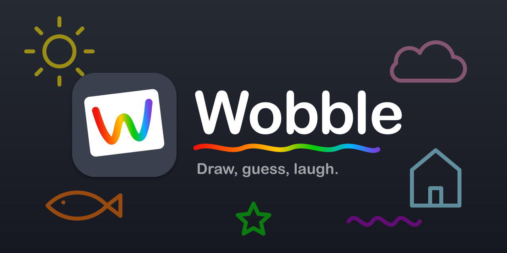

# Wobble

A Pictionary-style party game. Players join a room and take turns drawing:
the drawer picks one of three words and draws it, and everyone else races to
guess it in chat. Play in the browser from a link, or in the native desktop
app. Both play together in the same room.

**Play now:** <https://wobblegame.fly.dev> ·
**Desktop app:** <https://wobblegame.fly.dev/download>

## How it plays

- 2–12 players per room, 3 rounds, and everyone draws once per round.
- The drawer has 15 s to choose a word and 80 s to draw it. Letter hints are
  revealed at 50% and 75% of the drawing time.
- Faster correct guesses score more: 50 + 250 × the fraction of time left.
  The drawer gets 25 points for each player who guesses correctly.
- A guess one letter off gets a private "You're close!".

## Repository layout

| Path | What it is |
| --- | --- |
| [`backend/`](backend) | Elixir + Phoenix server. Runs one process per room, which holds the game state. Also serves the web client |
| [`client/`](client) | C11 client built on [Raven](https://oscar-soirey.github.io/Raven/), for macOS, Linux, Windows and WebAssembly |
| [`pen_test/`](pen_test) | A Raven test bench for pen and graphics-tablet input |
| [`SCRIBBLE_PLAN.md`](SCRIBBLE_PLAN.md) | Design doc: architecture, game rules and wire protocol |
| `Dockerfile`, `fly.toml` | Production image (web client + Phoenix release) and Fly.io config |

The server runs the game: clients send what the player did and draw what the
server tells them. Clients talk to it over standard Phoenix Channels (V2 JSON)
on one WebSocket, so any client that speaks that protocol can play.

## Quick start

You need Elixir/Erlang for the server and a C11 compiler with CMake for the
client.

```sh
# 1. Server
cd backend
mix setup
WOBBLE_FAST=1 mix phx.server   # WOBBLE_FAST=1 gives short timers for testing

# 2. Native client (in another terminal)
cd client
make                           # or: cmake -B build && cmake --build build
make run                       # opens the connect screen
# or join a room directly (on macOS the binary is build/wobble.app/Contents/MacOS/wobble)
./build/wobble --server ws://localhost:4000 --room abcd --name Ana

# 3. Some bots to play against
./build/wobble_bot -s ws://localhost:4000 -r abcd -n 2 -p 3
```

To play in the browser, build the web client (requires
[Emscripten](https://emscripten.org)) and open
<http://localhost:4000/r/abcd?name=Ana>:

```sh
cd client && make web          # copies the build into backend/priv/static/play
```

### Room links

A room's link, `https://<host>/r/<code>`, is all you need to share. Opened in
a browser, it goes straight into the room. Pasted into the desktop app (or
passed as an argument), it sets both the server and the room. See
[`client/README.md`](client/README.md) for details.

## Tests

```sh
cd backend && mix test
cd client  && make test
```

## Deploying

The Docker image builds the WebAssembly client and the Phoenix release
together, so deploy from the repo root:

```sh
fly deploy --ha=false   # one machine: rooms live in memory
```

See [`backend/README.md`](backend/README.md#deploying-to-flyio) for first-time
setup.

Desktop builds are published separately: push a `v*` tag and the Release
workflow builds `Wobble-macOS.dmg` and `.zip` and attaches them to a GitHub
release. The `/download` page always links to the latest release.

```sh
git tag v0.1.0 && git push origin v0.1.0
```

## License

[MIT](LICENSE)
