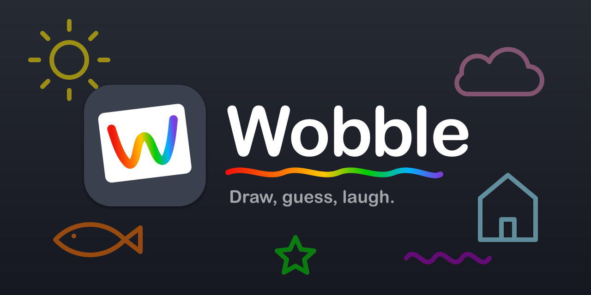

# macOS bundle art



| File | What it is |
| --- | --- |
| `icon.svg` | App icon, 1024px on the macOS icon grid; used for 64px and up |
| `icon-small.svg` | Simplified icon for 16 and 32px (no pencil or confetti, heavier W) |
| `Wobble.icns` | The built icon, copied into `wobble.app/Contents/Resources` |
| `banner.svg` / `banner.png` | Wordmark banner (Arial Rounded MT Bold) |
| `Info.plist.in` | Bundle plist, filled in by CMake |

The colours come from the game: the dark slate of the UI (`gui.xml`) and the
drawing palette (`game_palette` in `game.c`).

`Wobble.icns` and `banner.png` are committed, so the build never renders
anything. After editing an SVG, regenerate them by hand (needs `rsvg-convert`
from librsvg, plus `iconutil`, which ships with macOS):

```sh
cd src/macos
mkdir -p /tmp/Wobble.iconset
for s in 16 32 128 256 512; do
  for scale in 1 2; do
    px=$((s * scale)); src=icon.svg; [ $px -le 32 ] && src=icon-small.svg
    suffix=; [ $scale = 2 ] && suffix=@2x
    rsvg-convert -w $px -h $px $src -o /tmp/Wobble.iconset/icon_${s}x${s}$suffix.png
  done
done
iconutil -c icns /tmp/Wobble.iconset -o Wobble.icns
rsvg-convert -w 1280 banner.svg -o banner.png
```
